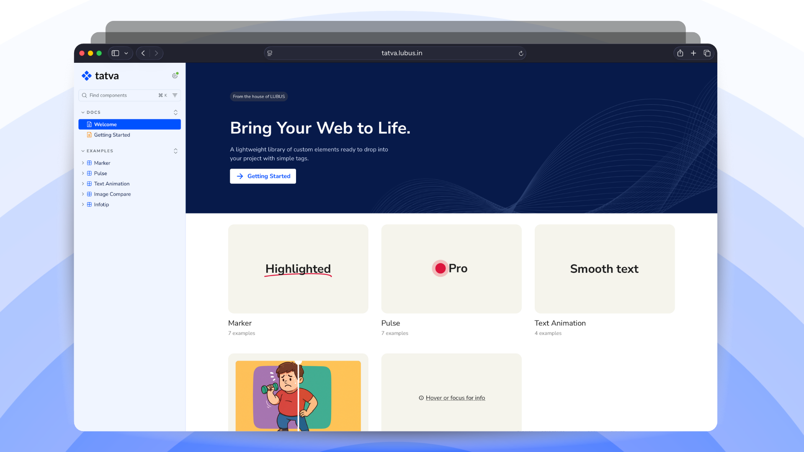

<!-- @format -->

<p align="center">
  
</p>



[](https://tatva.lubus.in/)
[](https://www.npmjs.com/package/@lubusin/tatva)

## tatva

 A Sanskrit word, `तत्त्व`, meaning `element`, is a Library of custom HTML elements / Web Components. Custom frontend functionality for our projects. 
 
 Powering functionality for our [WordPress Richtext Formats plugins](https://github.com/lubusIN/blablablocks-formats).

## Elements

Tatva provides a set of easy-to-use web components that work with any framework:

| Element                | Description                            |
| ---------------------- | -------------------------------------- |
| `tatva-marker`         | Highlight/underline animation for text |
| `tatva-pulse`          | Pulsing indicator for labels/badges    |
| `tatva-text-animation` | Text reveal and animation effects      |
| `tatva-image-compare`  | Image comparison (before/after) slider |
| `tatva-infotip`        | Small tooltip / infotip component      |

## Requirements

Tatva uses Floating UI internally to power advanced and reliable element positioning (for example, in components like `tatva-infotip`):

```html
<script src="https://cdn.jsdelivr.net/npm/@floating-ui/core@1.7.3"></script>
<script src="https://cdn.jsdelivr.net/npm/@floating-ui/dom@1.7.3"></script>
```

## Installation

#### via CDN

```html
<script type="module" src="https://unpkg.com/@lubusin/tatva/dist/index.js"></script>
```

#### via NPM

```bash
npm install @lubusin/tatva
```

## Usage

#### Load All Components

```js
// main.js
import '@lubusin/tatva/index.js';
```

#### Load a Single Component

```js
import '@lubusin/tatva/tatva-marker.js';
```

## Examples

#### Marker

```html
<tatva-marker type="underline" color="#dc143c" animation animation-duration="5s">
  Highlighted text
</tatva-marker>
```

#### Pulse

```html
<tatva-pulse
  position="superscript"
  size="0.75rem"
  color="#1e90ff"
  gap="8px"
  superscript-offset="-0.5em"
>
  Pro
</tatva-pulse>
```

## Meet Your Artisans

[LUBUS](https://lubus.in/?utm_source=github&utm_medium=open-source&utm_campaign=tatva) is a web design agency based in Mumbai.

<a href="https://cal.com/lubus">

</a>

## License

Tatva is open-sourced licensed under the [MIT License](LICENSE).
